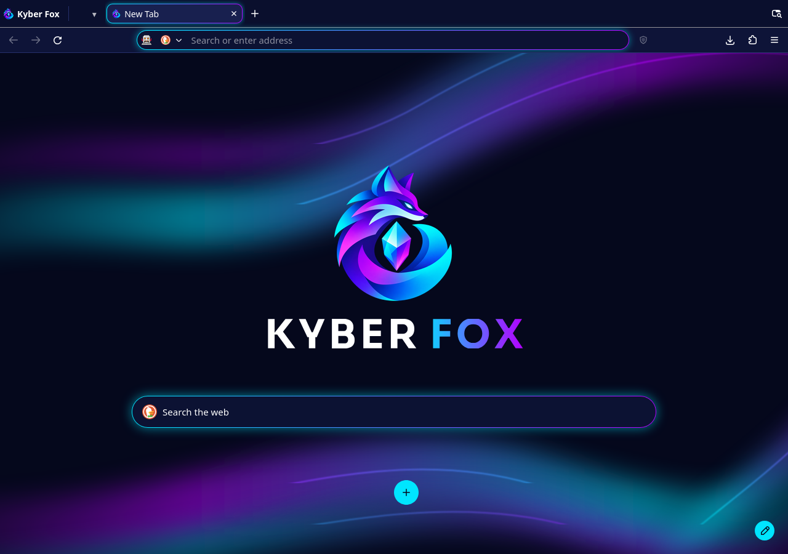
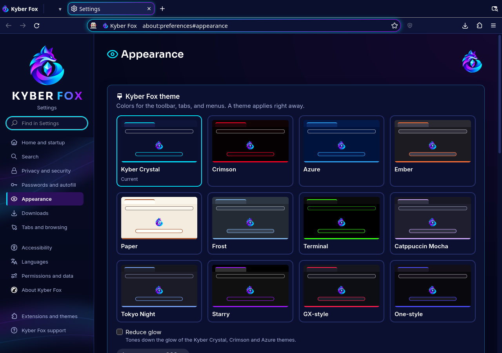
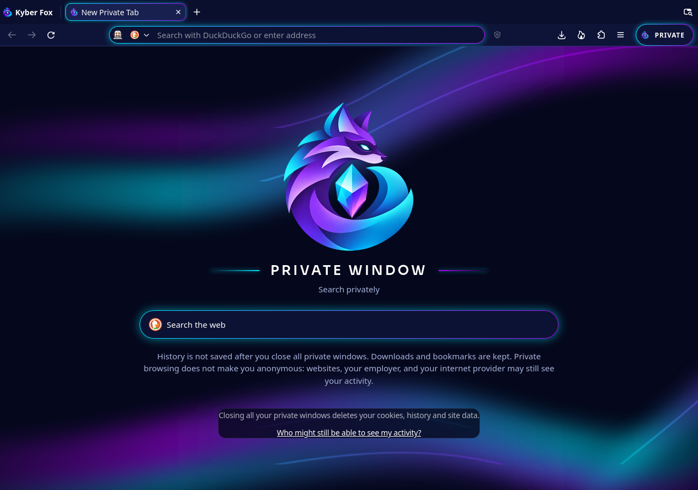

<div align="center">


# Kyber Fox

**A Firefox-based browser with privacy-focused defaults and a look of its own.**

[](https://github.com/Commanderx-code/KyberFox/actions/workflows/checks.yml)
[](LICENSE)
[](#project-status)

[Download alpha](https://github.com/Commanderx-code/KyberFox/releases) · [Installation](docs/install.md) · [Documentation](#documentation) · [Contribute](CONTRIBUTING.md)

</div>



*Development preview: Kyber Crystal, the default theme. Screenshots show the
interface on `main`; downloadable releases may not include every change yet.*

Kyber Fox combines Gecko with a customized browser interface, bundled uBlock
Origin, and privacy controls you can adjust globally or per site. Organize your
tabs with workspaces, choose a theme, and keep the familiar Firefox navigation,
extensions, and keyboard shortcuts.

## Highlights

| Feature | What you get |
| --- | --- |
| **A cohesive interface** | Kyber Crystal's deep navy surfaces and cyan and violet accents across tabs, toolbars, new tabs, and Settings. Horizontal and native vertical tabs remain available. |
| **Search your way** | New-tab search uses your configured search provider. Customize shortcuts, or open a private window with masked fox artwork and a persistent private indicator. |
| **Workspaces** | Named sets of tabs within a window, with Firefox's tab groups and split view available inside them. |
| **Per-site Shield** | Controls for bundled uBlock Origin and Firefox's fingerprinting and cookie protections. |
| **Privacy presets** | Standard and Strict presets, plus individual settings and native site-permission controls. Strict trades some compatibility and convenience for stronger restrictions. |
| **Themes and customization** | Kyber Crystal, Crimson, Azure, additional palettes, two full skins, and custom CSS import. Keyboard navigation, reduced-motion support, and a reduced-glow option are built in. |
| **A deliberate first run** | Choose your search engine and optional recommended add-ons. uBlock Origin is already included; additional add-ons install only when you choose them. |

<details>
<summary><strong>Explore the interface — Appearance and private browsing</strong></summary>

### Appearance

Choose a theme in Settings. Shared styles keep the browser and its internal
pages consistent without duplicating the interface for each palette.



### Private browsing

A dedicated new-tab design and a labeled toolbar indicator make private windows
easy to recognize.



</details>

## Install

Download builds from [GitHub Releases](https://github.com/Commanderx-code/KyberFox/releases).
Follow the [installation guide](docs/install.md) for setup, verification, and
importing data from another browser.

| Platform | Package | Updates |
| --- | --- | --- |
| **Windows x64** | Per-user installer | Signed automatic browser updates |
| **Arch Linux / Garuda x64** | Signed pacman repository | Through pacman |
| **Other Linux x64** | Portable tarball | Manual download and replacement |

The Windows installer is not code-signed yet, so SmartScreen may show a warning.
Installer signing and the signatures checked by the browser's update system are
separate; see the [installation guide](docs/install.md).

## Privacy, with clear boundaries

Telemetry, studies, sponsored content, and the upstream AI features are disabled
or removed. Firefox's security mechanisms, including the sandbox, site isolation,
certificate checks, and add-on blocklist, remain in place. Some connections are
still needed for updates, security data, and uBlock Origin's filter lists; the
[network audit](docs/network-audit.md) documents them.

The [privacy defaults](docs/privacy-defaults.md) explain each setting and its
compatibility costs. For example, Strict clears cookies and site data on exit
and disables WebGL, which can sign you out or break some sites. The
[Shield implementation notes](docs/shield-ublock-control.md) explain how per-site
controls interact with uBlock Origin and Firefox's protections.

Private browsing limits what is retained locally after you close all private
windows. Downloads and bookmarks remain. It does **not** make you anonymous:
websites, your employer, or your internet provider may still see your activity.
Workspaces organize tabs; they do not isolate cookies or signed-in accounts.

## Project status

**Kyber Fox is in alpha**, maintained by a small independent project. Windows
and Linux builds are available, but it is not considered stable. Real-machine
update checks and release validation remain part of the work.

Sync, macOS builds, and mobile apps are not currently available. Replacing
uBlock Origin with an in-tree blocking engine is
[research](docs/content-blocking-research.md), not an implemented feature.
See the [roadmap](ROADMAP.md) for planned work and the release notes for what
each downloadable build contains.

## Development

This repository assembles a pinned Firefox source release with selected
LibreWolf patches, focused Kyber Fox patches, and an overlay. The browsing
engine is Gecko. The repository holds the assembly and customization layers;
it does not check in the full Firefox source tree.

| Path | Purpose |
| --- | --- |
| [`pins.toml`](pins.toml) | Upstream versions and integrity hashes |
| [`patches/`](patches/) | Selected LibreWolf patches and Kyber Fox changes |
| [`overlay/`](overlay/) | Browser components, internal pages, branding, and browser tests |
| [`settings/`](settings/) | Preferences and policies |
| [`themes/`](themes/) | Shared styles, palettes, and skins |
| [`tools/`](tools/) | Assembly, validation, signing, and update tools |
| [`tests/`](tests/) | Python checks for the repository, tools, and defaults |

Start with [Contributing](CONTRIBUTING.md) and the
[architecture guide](docs/architecture.md). The
[build and preview guide](docs/build-gate.md) covers the artifact build used
for local interface work; [Linux build options](docs/build-linux.md) cover full
builds. Artifact previews use Mozilla's compiled engine and do not validate
Kyber Fox's C++ patches.

With the development environment set up, run the repository checks from its root:

```sh
.venv/bin/python -m pytest tests -q
```

Browser tests and release validation are described in the
[testing guide](docs/testing.md).

## Documentation

| Get started | Learn more | Maintain and contribute |
| --- | --- | --- |
| [Install and import data](docs/install.md) | [Architecture](docs/architecture.md) | [Contributing](CONTRIBUTING.md) |
| [Themes and custom CSS](docs/themes.md) | [Privacy defaults](docs/privacy-defaults.md) | [Testing](docs/testing.md) |
| [DRM and streaming](docs/streaming.md) | [Network audit](docs/network-audit.md) | [Security reporting](SECURITY.md) |
| [Project glossary](GLOSSARY.md) | [Vision](docs/vision.md) | [Upstream security updates](docs/upstream-updates.md) |
| [Roadmap](ROADMAP.md) | [Branding and assets](docs/branding.md) | [Release process](docs/release.md) |

<details>
<summary>Packaging, update infrastructure, and licensing</summary>

- [Arch package repository](docs/arch-repo.md)
- [Windows update signing](docs/update-signing.md)
- [Upstream release monitoring](docs/upstream-watch.md)
- [Content-blocking research](docs/content-blocking-research.md)
- [Licensing and trademark obligations](docs/licensing.md)

</details>

## Credits and license

Built on [Mozilla Firefox](https://www.firefox.com/) and selected work from
[LibreWolf](https://librewolf.net/), with
[uBlock Origin](https://github.com/gorhill/uBlock) by Raymond Hill.
Theme credits include Godiesc's [firefox-gx](https://github.com/Godiesc/firefox-gx)
and [firefox-one](https://github.com/Godiesc/firefox-one),
[starry-fox](https://github.com/sagars007/starry-fox),
[Catppuccin](https://github.com/catppuccin/catppuccin), and
[Tokyo Night](https://github.com/enkia/tokyo-night-vscode-theme).

Kyber Fox's own code is licensed under the
[Mozilla Public License 2.0](LICENSE). Third-party components retain their
licenses; attribution and font notices are in [themes/NOTICES.md](themes/NOTICES.md)
and the browser's `about:license` page. Kyber Fox is an independent project and
is not made or endorsed by Mozilla.
